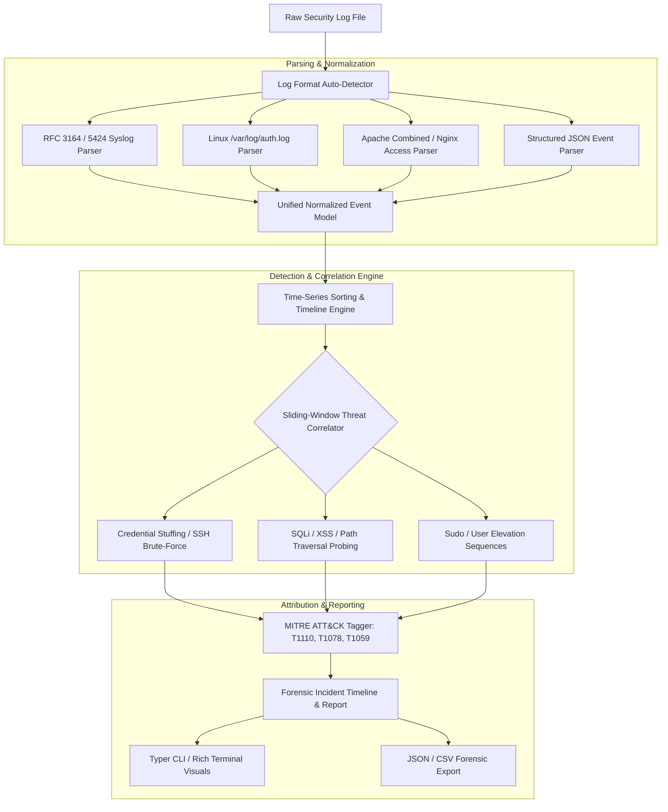

# Security Log Analyzer (`log-analyzer`)

Multi-Format Security Log Forensic Parser, Sliding-Window Threat Correlator, Time-Series Anomaly Detector, and MITRE ATT&CK Tagger.

[](https://github.com/Krish9800/security-log-analyzer/actions)
[](LICENSE)
[](https://www.python.org/)
[](https://typer.tiangolo.com/)
[](https://attack.mitre.org/)

---

## Overview & Problem Statement

During security incident response, analysts receive heterogeneous log exports from disparate infrastructure components—Linux authentication logs, web server access logs (Apache/Nginx), firewalls, and custom application event streams. Manual inspection of massive multi-gigabyte flat files is slow and prone to overlooking coordinated multi-stage attack patterns.

**Security Log Analyzer** is a high-speed forensic log parsing and threat analysis utility. It auto-detects log formats, normalizes disparate records into unified time-series events, correlates suspicious activity using sliding time-windows, maps observed indicators to MITRE ATT&CK tactics, and generates structured forensic investigation reports.

---

## Architecture & Data Flow



---

## Verified Features

- **Format Auto-Detection:** Automatically identifies and parses Syslog (RFC 3164 / 5424), Linux auth logs, Apache/Nginx combined access logs, and generic structured JSON.
- **High-Speed Ingestion:** Streaming file processing handles large log dumps with low memory footprint.
- **Sliding-Window Correlation:** Correlates events across timestamps to identify complex multi-stage attacks (e.g. 5 failed logins within 60s followed by an accepted sudo session).
- **MITRE ATT&CK Tagger:** Tags detected anomalies with specific enterprise ATT&CK techniques (e.g., T1110.001, T1078, T1190).
- **Statistical Aggregation:** Computes top source IPs, targeted usernames, HTTP status code distributions, and anomaly outlier scores.
- **Dual Interface:** Typer CLI with rich terminal formatting, plus a headless FastAPI inspection service.

---

## Technology Stack

- **Runtime:** Python 3.12+
- **Data Validation:** Pydantic v2
- **CLI Framework:** Typer & Rich
- **API Framework:** FastAPI & Uvicorn
- **Quality Gates:** Pytest, Ruff, Mypy Strict, Bandit

---

## Requirements & Installation

```bash
# Clone the repository
git clone https://github.com/Krish9800/security-log-analyzer.git
cd security-log-analyzer

# Create and activate virtual environment
python3 -m venv .venv
source .venv/bin/activate

# Install dependencies
pip install -e .
```

---

## Verified Usage Examples

### 1. Command-Line Interface (CLI)

```bash
# Inspect a log file to auto-detect format and record count
log-analyzer inspect /var/log/auth.log

# Perform full forensic analysis and correlation on an authentication log
log-analyzer analyze /var/log/auth.log

# Analyze a web server access log with JSON output export
log-analyzer analyze /var/log/nginx/access.log --format json --output forensic_report.json

# List active correlation and forensic detection rules
log-analyzer rules
```

Sample Forensic Summary Output:
```
============================================================
FORENSIC THREAT CORRELATION REPORT
============================================================
Total Events Processed: 14,820
Correlated Threats Identified: 3

[!] THREAT DETECTED: SSH Brute-Force Sequence (MITRE T1110.001)
  Source IP: 203.0.113.42
  Failed Attempts: 47 within 120s
  Targeted Accounts: ['root', 'admin', 'ubuntu', 'deploy']

[!] THREAT DETECTED: Suspicious Privilege Escalation (MITRE T1078)
  User: deploy -> root via sudo
  Timestamp: 2026-10-14 08:42:15 UTC
```

### 2. REST API Service

```bash
# Start the forensic analyzer API
uvicorn loganalyzer.api.app:app --host 127.0.0.1 --port 8000
```

Endpoints available at `http://127.0.0.1:8000/docs`:
- `GET /health` — Service health check
- `GET /api/v1/rules` — List active correlation rules
- `POST /api/v1/analyze` — Upload log file for forensic parsing

---

## Testing & Quality Gates

```bash
# Run unit and forensic parsing tests
pytest --cov=loganalyzer --cov-report=term-missing

# Linting and static analysis
ruff check .
ruff format --check .
mypy src/loganalyzer
```

---

## Security Model & Threat Boundaries

- **Log Injection Resistance:** Parsers escape terminal control sequences and line terminators to prevent log spoofing and terminal injection exploits.
- **Offline Safe Parsing:** Log parsing operates strictly in memory without connecting to external services; internal IP addresses and usernames are never transmitted externally.

---

## Limitations & Known Issues

- **Windows EVTX Files:** Supports text and JSON-exported Windows event logs; raw proprietary binary `.evtx` parsing requires pre-export to JSON/XML.
- **Unstructured Custom Formats:** Non-standard application log formats without regular timestamp delimiters require custom regex rule definitions.

---

## License & Responsible Use

This project is licensed under the **MIT License** — see the [LICENSE](LICENSE) file for details.

> [!NOTE]
> Designed for incident responders, digital forensics analysts, and security operations engineers.
