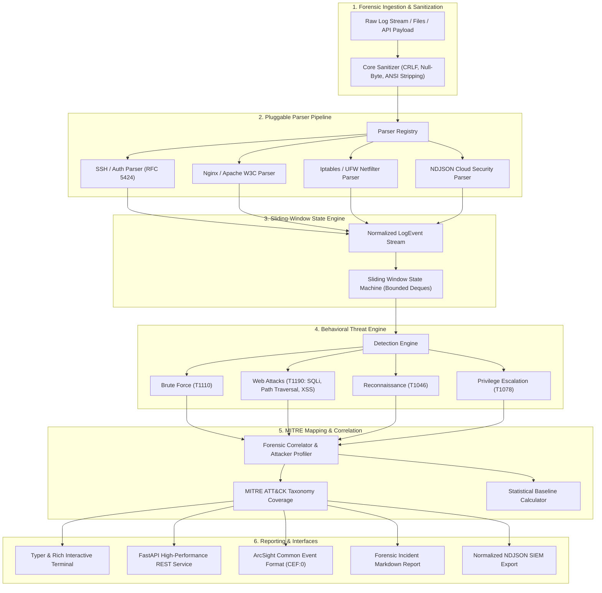

# System Architecture & Forensic Design

The **Security Log Analyzer** is designed as a modular, high-throughput, SIEM-grade forensic analysis system. It transforms heterogeneous raw system, web, network, and firewall logs into structured telemetry mapped against the **MITRE ATT&CK Enterprise Matrix**.

---

## 1. High-Level Subsystem Architecture

---

## 2. Canonical Data Models

### 2.1 `LogEvent`
Every incoming log record is normalized into an immutable, strictly-typed Pydantic model:
- `timestamp`: UTC ISO-8601 standardized datetime.
- `source_type`: Log format identifier (`auth_log`, `web_w3c`, `firewall_netfilter`, `cloud_json`).
- `raw_message`: Sanitized original message.
- `source_ip` / `destination_ip`: Standardized `IPvAnyAddress` objects.
- `source_port` / `destination_port`: Integer ports with validation.
- `event_type`: Categorical taxonomy (`auth_failure`, `auth_success`, `http_request`, `packet_drop`, `sudo_command`).
- `status`: Result outcome (`success`, `failure`, `blocked`, `info`).
- `user`: Account identity extracted from log context.
- `process_name` / `pid`: Originating system process and identifier.
- `metadata`: Flexible contextual dictionary (e.g., HTTP method, user agent, TCP flags).

### 2.2 `Incident`
Represents an aggregated, validated security alert:
- `incident_id`: Deterministic or UUID forensic identifier.
- `title`: Standardized alert description.
- `severity`: Standardized CVSS-aligned ranking (`CRITICAL`, `HIGH`, `MEDIUM`, `LOW`, `INFO`).
- `attacker_ip`: Attribution candidate IP.
- `mitre_technique`: Mapped MITRE ATT&CK identifier (e.g. `T1110`, `T1190`, `T1046`, `T1078`).
- `event_count`: Number of correlated raw events.
- `evidence`: Sample raw event strings demonstrating the attack.
- `recommendation`: Contextual incident response guidance.

---

## 3. Sliding-Window State Engine
To prevent memory exhaustion attacks and unbounded state growth when processing gigabyte-scale logs:
1. **Source IP Indexing**: Events are partitioned into temporal ring buffers keyed by attacker IP.
2. **Deterministic Pruning**: Events falling outside the configurable temporal threshold (`window_seconds`) are evicted.
3. **Capacity Caps**: The deque enforces a hard limit of `max_events_per_ip` to guarantee $O(1)$ amortized memory operations.
